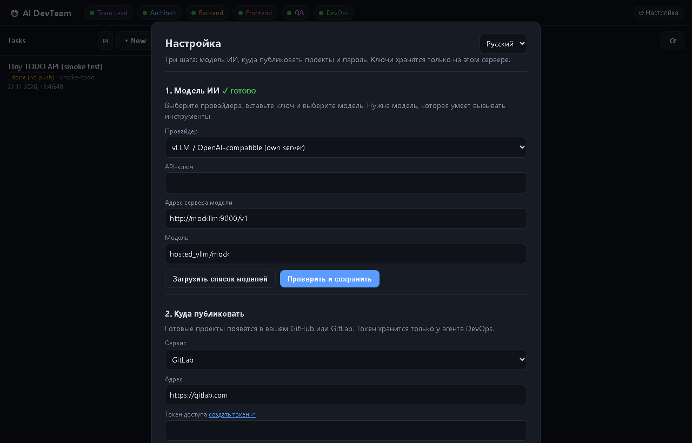

# AI DevTeam

[](https://github.com/nikvladimirovich2/ai-devteam/actions/workflows/ci.yml)
[](LICENSE)
[](https://github.com/sponsors/nikvladimirovich2)
[](#support-the-author)
[](#support-the-author)

**A self-hosted AI development team that turns a task into a tested project in your own GitLab or GitHub,
using your own model.** Built for closed environments: vLLM / Ollama / GigaChat, private CA
certificates, corporate GitLab, no data leaves your network except the calls to your model.

> ⚠️ The agents run shell commands written by a language model. Deploy it on a dedicated host and read
> [SECURITY.md](SECURITY.md) first.

A team of 6 AI agents built on [CrewAI](https://github.com/crewAIInc/crewAI). Each agent runs in its own Docker container
under its own API key to the corporate LLM. You give the Team Lead a task in the web interface and get back a finished
project pushed to the corporate **GitLab or GitHub** (chosen by the URL in `GIT_URL`).

| Container            | Role               | What it does                                                    |
|----------------------|--------------------|-----------------------------------------------------------------|
| `devteam-lead`       | Team Lead          | web UI, plan + acceptance criteria, distributes work, accepts the result |
| `devteam-architect`  | Architect          | `ARCHITECTURE.md`, stack, API contracts, project skeleton       |
| `devteam-backend`    | Backend Developer  | server side + unit tests                                        |
| `devteam-frontend`   | Frontend Developer | user interface                                                  |
| `devteam-qa`         | QA Engineer        | autotests, runs, verdict; sends defects back to the owner       |
| `devteam-devops`     | DevOps Engineer    | Dockerfile, compose, CI, README, **push to GitLab/GitHub** |

## Process

```
you → Lead (plan) → Architect → Backend ∥ Frontend → QA ─┬─ passed → DevOps → GitLab/GitHub → Lead (report)
                                                     └─ issues → fixes by owners → QA (up to MAX_QA_ROUNDS)
```

The whole process is visible live in the UI: assignments, agent thoughts, commands and their output, written files,
QA verdict and the link to the repository. After completion you can send a **revision** — the team changes the existing project.

## Quick start

**1. Install** (downloads the ready image, starts the team, opens the browser):

| System | Command | Needs |
|---|---|---|
| Windows 10/11 | in PowerShell: `irm https://raw.githubusercontent.com/nikvladimirovich2/ai-devteam/main/install.ps1 \| iex` | WSL 3.0.1+ (the installer updates it) |
| Linux / macOS | `curl -fsSL https://raw.githubusercontent.com/nikvladimirovich2/ai-devteam/main/install.sh \| bash` | Docker with Compose v2 |

**2. Set up in the browser** (⚙ Setup opens by itself the first time):
1. **AI model:** pick the provider (OpenAI, Anthropic, Gemini, OpenRouter, DeepSeek, Ollama, vLLM…), paste the key,
   choose a model, **Check and save**. The check makes sure the model can call tools.
2. **Where to publish:** GitHub or GitLab, a token (the link opens the token page with the right boxes ticked), **Check and save**.
3. **Password** for the interface (optional on your own computer).

**3. Give a task** and wait for the report with the link to the repository.



Updating: run the installer again. On Windows, after a restart: the **AI DevTeam** shortcut on the desktop.
Company certificates (private CA): put `*.crt` into the `certs` folder of the installation and restart.

> Works best for small and medium projects (a website, a bot, an API, an internal service). Review the result
> before using it in production.

Manual installation, servers, all settings: **[DEPLOY.md](DEPLOY.md)** · [на русском](DEPLOY.ru.md) · [na srpskom](DEPLOY.sr.md) · [中文](DEPLOY.zh.md). Model choice per role: **[MODELS.md](MODELS.md)**.

<details><summary>From the source code (developers, closed networks)</summary>

```bash
git clone https://github.com/nikvladimirovich2/ai-devteam.git /opt/devteam && cd /opt/devteam
cp .env.example .env && chmod 600 .env
echo "INTERNAL_SECRET=$(openssl rand -hex 32)" >> .env   # signs requests between the containers
cp /path/to/ca.crt agent/certs/    # only if the LLM/GitLab uses a private CA
docker compose -f docker-compose.yml -f docker-compose.build.yml up -d --build
./scripts/check.sh                 # pre-flight check
```

The model and Git can be set in `.env` instead of the browser (values in `.env` win), see below.
**Windows:** `.\scripts\wslc-up.ps1 -Build`, see [DEPLOY.md § 11](DEPLOY.md#11-windows-wsl-containers-wslc).
</details>

The UI listens on `127.0.0.1:8080` (`UI_BIND`/`UI_PORT`). On a server, open it through an SSH tunnel:

```bash
ssh -L 8080:localhost:8080 user@<host>          # add -J user@jump:port if needed
# → http://localhost:8080
```

To publish directly (`UI_BIND=0.0.0.0`), set a password (⚙ Setup, or `UI_USER`/`UI_PASSWORD`) and use TLS.

### `.env` settings

| Variable | Meaning |
|---|---|
| `LLM_MODEL` | model in LiteLLM format: `ollama/qwen2.5-coder:32b`, `hosted_vllm/Qwen2.5-Coder-32B`, `openai/<name>` (any OpenAI-compatible API), `gigachat/GigaChat-2-Max` |
| `LLM_BASE_URL` | API address of the model (Ollama: `http://host:11434`, vLLM/OpenAI-compatible: `https://host/v1`) |
| `<ROLE>_API_KEY` | personal key for each role: `LEAD`, `ARCHITECT`, `BACKEND`, `FRONTEND`, `QA`, `DEVOPS` |
| `<ROLE>_MODEL` | optional: a separate model for a role (e.g. a stronger one for the architect) |
| `GIT_URL` | repository host. Host containing `github` → **GitHub** (github.com or Enterprise `https://ghe.host`, API `/api/v3`), otherwise → **GitLab** |
| `GIT_PROVIDER` | `gitlab`/`github` — force it if the URL does not show the type (e.g. GHE at `https://code.corp.local`) |
| `GIT_TOKEN` | GitLab: PAT with `api` + `write_repository`. GitHub: fine-grained PAT (All repositories; Administration RW, Contents RW, Workflows RW) or classic with `repo` + `workflow` |
| `GIT_NAMESPACE` | GitLab: group for new projects (required). GitHub: organization (empty = the token owner's personal account) |
| `MAX_QA_ROUNDS` | how many times QA can send work back for fixes |
| `LLM_SSL_VERIFY_DISABLE`, `GIT_SSL_VERIFY_DISABLE` | `1` for self-signed certificates |

### Corporate / self-signed certificates (LLM and GitLab over HTTPS)

Put the PEM certificate (`*.crt`, `-----BEGIN CERTIFICATE-----`) into `agent/certs/` and rebuild:

```bash
cp llm.crt agent/certs/ && docker compose build && docker compose up -d
```

The certificate is added to the system store and to `certifi` (used by LiteLLM/httpx), plus `REQUESTS_CA_BUNDLE`,
`SSL_CERT_FILE`, `NODE_EXTRA_CA_CERTS` — so it is trusted by the agents, git and the npm/pip/node they run.
`agent/certs/*.crt` is not committed (in `.gitignore`) — copy it on every host.
The certificate must contain the host from `LLM_BASE_URL` in its SAN (an IP address — as `IP Address:`).
`LLM_SSL_VERIFY_DISABLE=1` is a last resort; it turns off verification entirely.

### Model requirements (tool calling)

Agents work through tools (`write_file`, `run_shell`, `publish_repository`). The model must support
**native function calling**. For vLLM that means starting it with
`--enable-auto-tool-choice --tool-call-parser hermes` (Qwen2.5/Qwen3; for other families — the matching parser).
LiteLLM does not know self-hosted models, so `LLM_FUNCTION_CALLING=auto` turns native tool calls on
for `hosted_vllm/`, `ollama/` and similar. Without it the model often just *describes* the code instead of writing it.

The Team Lead checks the result itself: if an agent reported success but wrote no files, the task stops
with a clear error; the repository link is taken only from a real push, and if DevOps did not call
publishing, the lead publishes the project directly.

### Final report

At the end of each run (including revisions, the 🔧 CI button, errors and cancellation) the Team Lead writes
a plain-text report into the feed: status, duration, repository and commits, completed stages, QA verdicts and
test runs (pytest/npm test with their result), CI result, errors, project files and a **token table per role**
(calls, requests to the model, input/output/total) with the total. For revisions an extra line shows the
total for the whole task. Report buttons: 📋 copy, ⬇ .txt. API: `GET /api/tasks/<id>/report` (`?full=1` — the whole task).
Copies are stored in the `workspace` volume: `/workspace/.reports/<task-id>.txt`.
Token counts are taken from the usage field of the model responses; if the provider does not return them, the report says so.
The model context window is taken automatically from vLLM (`/v1/models` → `max_model_len`) or from `LLM_CONTEXT_WINDOW`.

### CI check and automatic fixing

After the push the Team Lead waits for the pipeline of that commit (GitLab CI / GitHub Actions):

1. `✅ CI passed` — the task is finished.
2. `❌ CI failed` — the logs of the failed jobs are handed to DevOps: it finds the cause, reproduces it in a clean
   venv (as in CI), fixes the code/requirements/CI config and pushes again. Up to `MAX_CI_ROUNDS` rounds;
   if CI is still red, the task gets the `CI failed` status.
3. No pipeline within 3 minutes (no CI config, CI disabled, no runners) or a `CI_WAIT_TIMEOUT` timeout — a
   warning, the task is finished.

The **🔧 CI** button in an open task starts the same check/fix again for an already published project
(e.g. after a CI failure in an old task). GitLab needs a token with `api` (read pipelines and job logs),
GitHub needs `Actions: Read` (fine-grained) in addition to Contents/Administration/Workflows.

### Values containing `$` in `.env`

Docker Compose expands `$VAR` in `.env`. If a key/token contains `$`, wrap the value in **single quotes**:
`QA_API_KEY='$abc#def'`. Otherwise part of the key is lost (the warning `The "X" variable is not set` gives it away).

## Example task

A good first check — touches all 6 roles, has something to test, and CI:

```
Build a URL shortener service (url-shortener).

Backend: Python 3.12 + FastAPI, SQLite storage (DB file path from DB_PATH env var, default ./data.db).
API:
- POST /api/links — body {"url": "..."}; url required, http/https only, up to 2000 chars.
  201: {"code": "<6 chars [a-zA-Z0-9]>", "url": "...", "short_url": "/r/<code>", "clicks": 0}.
  POSTing the same url again returns the existing code.
- GET /api/links — list, newest first.  GET /api/links/{code} — info, 404 if missing.
- DELETE /api/links/{code} — 204, 404 if missing.
- GET /r/{code} — 307 redirect to the original url, clicks +1; 404 if missing.
- GET /health — {"status":"ok"}.  Errors as JSON with 404/422.
Frontend: one plain HTML/JS page (no bundlers) served by the same FastAPI: shorten form,
table (short link, url, clicks), copy and delete buttons.
Tests: pytest for all endpoints incl. errors; each test on its own temporary DB.
Delivery: Dockerfile, README with run commands, CI installing deps from requirements and running tests.
Repository name: url-shortener.
```

Then, as a revision: *«Add optional ttl_days (1–365) to POST /api/links; an expired link returns 410 Gone
on /r/{code} and does not count a click. Add tests.»*

## Security

- Each container receives **only its own** API key; `GIT_TOKEN` exists only in `devops`.
- Commands that agents run in the shell are executed as a separate user `runner` with an environment cleared of
  `*API_KEY*`/`*TOKEN*`/`*PASSWORD*`/`*SECRET*`: they cannot read the agent's environment or memory via `/proc`.
- The token is passed to git through the environment for the duration of the push — not on the command line,
  not in `.git/config`, not in the logs.
- Internal requests between the containers are signed (`INTERNAL_SECRET`); unsigned calls get `403`.
- Agents work without root and without access to the Docker socket. `.env` is in `.gitignore`.
- Details, limits and how to report a vulnerability: [SECURITY.md](SECURITY.md).

## Data

- `workspace` volume — the projects' working directories (`/workspace/<task-id>`), shared by all agents.
- `leaddata` volume — SQLite with the task and event history.

```bash
docker compose logs -f lead backend      # logs
docker compose down                      # stop (data is kept)
docker compose down -v                   # stop and delete data
```

## Smoke test without a real model

```bash
bash tests/smoke.sh     # mock LLM, one task through all roles + isolation checks (the same as CI)
```

`tests/` also contains a temporary GitLab CE (~4 GB RAM) to check the whole pipeline down to the push:

```bash
docker compose build
export TEST_GITLAB_ROOT_PASSWORD="$(openssl rand -base64 18)"
docker compose -f docker-compose.yml -f tests/docker-compose.test.yml up -d
# in .env for the test: LLM_MODEL=openai/mock, LLM_BASE_URL=http://mockllm:9000/v1, keys — any,
# GIT_URL=http://gitlab, GIT_NAMESPACE=root, GIT_TOKEN — a token created in the test GitLab
```

## Layout

```
docker-compose.yml       6 agent services (prebuilt image)
docker-compose.build.yml build the image from source instead
install.sh / install.ps1 one-command installers
.env.example             configuration template
agent/Dockerfile         shared image (role is set by ROLE)
agent/app/lead.py        Team Lead: FastAPI UI/API, orchestration, SQLite
agent/app/worker.py      role agent: POST /run → CrewAI Agent + tools
agent/app/common.py      LLM factory (per-role key), tools: files/shell, events
agent/app/setup_checks.py setup wizard: providers, connection checks, error messages (en/ru)
agent/app/repo_tool.py   creating a repository and pushing (GitLab API v4 / GitHub API v3)
agent/app/roles.py       role descriptions (prompts)
agent/app/static/        web interface
tests/                   mock LLM, smoke test, test GitLab
scripts/wslc-*.ps1       start/stop on Windows (WSL containers)
scripts/check.sh         pre-flight check of a deployment
DEPLOY.md                deployment guide
MODELS.md                which model for which role
```

## Contributing

Issues and pull requests are welcome, see [CONTRIBUTING.md](CONTRIBUTING.md). Changes: [CHANGELOG.md](CHANGELOG.md).

## Support the author

AI DevTeam is free and open source. If it saves you time, you can support its development:

[](https://github.com/sponsors/nikvladimirovich2)

**Crypto** (scan the QR code with your wallet or copy the address):

| USDT · **TRC20** (Tron) | USDC · **Solana** |
|:---:|:---:|
|  |  |
| `TWxXpymgNDHtRo5XN2oHUoB2TN3PuHQ5S9` | `Bp4ZTpF8SaZhY6Xv9NwbfiZ6RLFAioZWipyMHUb4emAD` |

Send each token **only on its network**: USDT only via TRC20 (Tron), USDC only via Solana.
A transfer on another network or of another token is lost.

A star ⭐ and a link to the project help too.

## License

[GNU AGPL-3.0](LICENSE). You may use, change and share it, including commercially. If you run a changed
version as a network service, you must make your changes available to its users under the same license.

